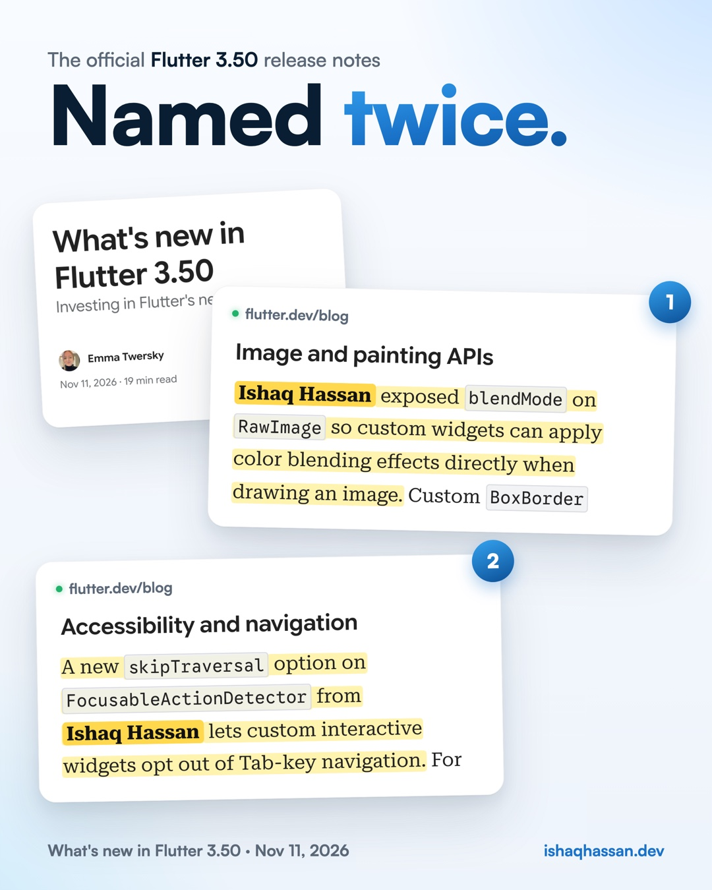
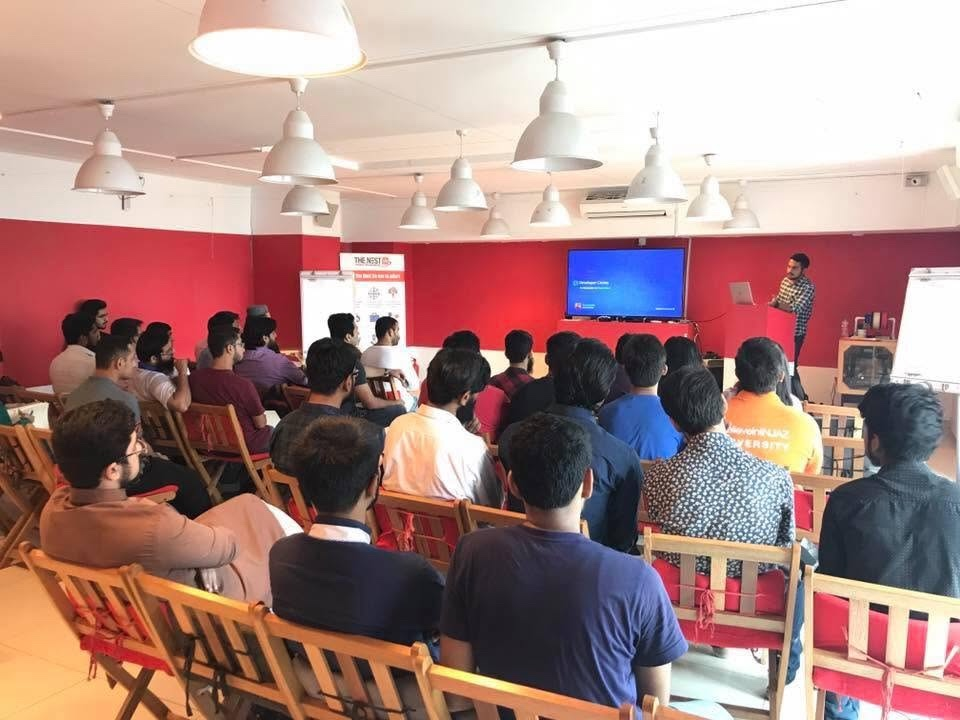

  

---

### `> whoami`

**Flutter Framework Contributor from Pakistan, listed in Flutter's [Authors list](https://github.com/flutter/flutter/blob/master/AUTHORS#L150).** 13+ years in software engineering, based in Karachi. Currently **Engineering Manager** at [DigitalHire](https://digitalhire.ai), building the world's first integrated talent engine.

I contribute directly to the **Flutter ecosystem**. **15 pull requests merged into the official Flutter org repos** (12 in [flutter](https://github.com/flutter/flutter), 3 in [devtools](https://github.com/flutter/devtools)) with 5 more in active review. Two of them were called out by name in the official **[Flutter 3.50 release notes](https://flutter.dev/blog/whats-new-in-flutter-3-50)**. My work spans painting APIs, focus and keyboard navigation, animation APIs, `flutter_tools`, DevTools internals, and documentation.

Instructor of the **Flutter Urdu course** officially listed on [docs.flutter.dev/resources/courses](https://docs.flutter.dev/resources/courses#urdu). GDG Kolachi Mentor. 50+ production apps shipped.

---

### 📰 Named twice in the Flutter 3.50 release notes

<table>
<tr>
<td width="40%" align="center">

</td>
<td width="60%">

The official **[What's new in Flutter 3.50](https://flutter.dev/blog/whats-new-in-flutter-3-50)** post (Nov 11, 2026) credits two of my framework PRs by name:

> **Image and painting APIs** 
> "Ishaq Hassan exposed `blendMode` on `RawImage` so custom widgets can apply color blending effects directly when drawing an image."

> **Accessibility and navigation** 
> "A new `skipTraversal` option on `FocusableActionDetector` from Ishaq Hassan lets custom interactive widgets opt out of Tab-key navigation."

188 contributors landed 1,200+ commits in this release cycle.

➡️ [#185938 blendMode](https://github.com/flutter/flutter/pull/185938) · [#191308 skipTraversal](https://github.com/flutter/flutter/pull/191308) · [The story behind blendMode](https://ishaqhassan.dev/blog/flutter-rawimage-blendmode.html)

</td>
</tr>
</table>

---

### 🔥 Flutter Ecosystem PRs (15 Merged + 5 Open)

Contributions across the [official Flutter org repos](https://github.com/flutter), the framework and tooling that millions of developers use:

| PR | Repo | Title | Status |
|:---|:-----|:------|:------:|
| [#10050](https://github.com/flutter/devtools/pull/10050) | devtools | Fix stale "no timeline event analysis data" message in Frame Analysis tab | ✅ Merged |
| [#194934](https://github.com/flutter/flutter/pull/194934) | flutter | [flutter_tools] Stream web dev server proxy responses instead of buffering them | ✅ Merged |
| [#193151](https://github.com/flutter/flutter/pull/193151) | flutter | [flutter_tools] Report malformed plugin platform entries instead of crashing | ✅ Merged |
| [#191308](https://github.com/flutter/flutter/pull/191308) | flutter | Expose skipTraversal in FocusableActionDetector | ✅ Merged · 📰 3.50 notes |
| [#190130](https://github.com/flutter/flutter/pull/190130) | flutter | Forward --build-name and --build-number to desktop version.json | ✅ Merged |
| [#185938](https://github.com/flutter/flutter/pull/185938) | flutter | Add blendMode parameter to RawImage and RenderImage | ✅ Merged · 📰 3.50 notes |
| [#9855](https://github.com/flutter/devtools/pull/9855) | devtools | Keep network search field enabled after clearing calls | ✅ Merged |
| [#186943](https://github.com/flutter/flutter/pull/186943) | flutter | Document moveStep direction on WidgetController.dragUntilVisible | ✅ Merged |
| [#9822](https://github.com/flutter/devtools/pull/9822) | devtools | Fix SplitPane RangeError when child count changes between rebuilds | ✅ Merged |
| [#184545](https://github.com/flutter/flutter/pull/184545) | flutter | Add `clipBehavior` parameter to AnimatedCrossFade | ✅ Merged |
| [#184569](https://github.com/flutter/flutter/pull/184569) | flutter | Add disposal guidance to CurvedAnimation and CurveTween docs | ✅ Merged |
| [#184572](https://github.com/flutter/flutter/pull/184572) | flutter | Fix LicenseRegistry docs to reference NOTICES | ✅ Merged |
| [#183109](https://github.com/flutter/flutter/pull/183109) | flutter | Add `scrollPadding` property to DropdownMenu | ✅ Merged |
| [#183097](https://github.com/flutter/flutter/pull/183097) | flutter | Fix RouteAware.didPushNext documentation | ✅ Merged |
| [#183081](https://github.com/flutter/flutter/pull/183081) | flutter | Use double quotes in settings.gradle.kts template | ✅ Merged |
| [#195952](https://github.com/flutter/flutter/pull/195952) | flutter | [flutter_tools] Use the generic macOS destination when the host arch is in EXCLUDED_ARCHS | 🔄 Open |
| [#10054](https://github.com/flutter/devtools/pull/10054) | devtools | Fix Performance page loading forever when the systrace recorder is in use | 🔄 Open |
| [#194071](https://github.com/flutter/flutter/pull/194071) | flutter | Print the Intel Mac deprecation warning on every command | 🔄 Open |
| [#186142](https://github.com/flutter/flutter/pull/186142) | flutter | Update iOS section of AppLocalizations template to current Xcode workflow | 🔄 Open |
| [#183062](https://github.com/flutter/flutter/pull/183062) | flutter | Reset AppBar _scrolledUnder flag when scroll context changes | 🔄 Open |

Also merged in the Flutter org: [#190064](https://github.com/flutter/flutter/pull/190064) added me to Flutter's [Authors list](https://github.com/flutter/flutter/blob/master/AUTHORS#L150), and [website#11663](https://github.com/flutter/website/pull/11663) added my Urdu course to the official docs.

Areas: painting APIs, focus traversal, widget rendering, animation APIs, `flutter_tools` (plugins, web dev server, desktop builds), DevTools UI, test framework docs, documentation accuracy.

---

### 🎤 Speaker & Community Leader

<table>
<tr>
<td align="center" width="33%">
<h4>14</h4>
Talks, Workshops & Codelabs
</td>
<td align="center" width="33%">
<h4>GDG Mentor</h4>
Official Mentor @ GDG Kolachi
</td>
<td align="center" width="33%">
<h4>Inaugural</h4>
Speaker @ Nest I/O DevCircle
</td>
</tr>
</table>

**Conferences & Events:**

| Event | Venue | Role |
|:------|:------|:-----|
| [TechBridge 2026: Connecting Students with Industry Leaders](https://www.facebook.com/photo?fbid=1376875151137419&set=a.550564113768531) Industry Guest Speaker Seminar + IAB @ Iqra University Gulshan Campus (May 21, 2026) | [Iqra University](https://iqra.edu.pk/) | Industry Guest Speaker (Industrial Advisory Board) |
| [DevFest Karachi 2021](https://x.com/GDGKolachi/status/1466038791257440267) "Scaling Products with Flutter" | [GDG Kolachi](https://gdg.community.dev/gdg-kolachi/) | Panel Speaker (with Waleed Arshad & Sakina Abbas) |
| [Google I/O Extended Karachi 2023](https://www.facebook.com/photo/?fbid=720743350091964&set=a.478629590970009) Workshop: "Flutter's Future with Stacked: Mastering MVVM" @ IBA City Campus | [GDG Kolachi](https://gdg.community.dev/gdg-kolachi/) | Workshop Speaker |
| [Google I/O Extended Karachi 2022](https://www.facebook.com/photo/?fbid=2633195370147637&set=a.478629590970009) "Native Code Integration With Flutter" @ Iqra University | [GDG Kolachi](https://gdg.community.dev/gdg-kolachi/) | Speaker |
| [Google I/O Extended Karachi 2021](https://www.facebook.com/photo/?fbid=2320727104727800&set=gm.409820913712109&idorvanity=397300131630854) LIVE Coding Session: built "Fire Classifieds" Flutter app on stage @ NIC | [GDG Kolachi](https://gdg.community.dev/gdg-kolachi/) | Live Coder (with Huzaifa Ahmed & Waleed Arshad) |
| [Google I/O Extended Karachi 2019](https://www.facebook.com/GDGKolachi/posts/pfbid025gy6zArzUfWiGdZLNAkYc1x4c5tXayPGpm99pQW615P4cK3q6TGzER2QS9baopETl) Android Data Binding codelab @ Habib University | [GDG Kolachi](https://gdg.community.dev/gdg-kolachi/) | Codelab Speaker |
| [Flutter Bootcamp (Aug 21-22, 2021)](https://www.facebook.com/photo/?fbid=2344181145715729&set=gm.524808955453217&idorvanity=524788112121968) online, with Women Techmakers Kolachi | [GDG Kolachi](https://gdg.community.dev/gdg-kolachi/) | Instructor |
| [Flutter Study Jam 2020](https://www.facebook.com/photo/?fbid=1817097918424057&set=a.478629590970009) "Build your first Flutter Application" | [GDG Kolachi](https://gdg.community.dev/gdg-kolachi/) | Official Trainer |
| [Flutter Seminar](https://www.linkedin.com/posts/itrathussainzaidi_flutter-iqrauniversity-seminar-activity-7192627199412232192-8t2X) | [Iqra University](https://iqra.edu.pk/) | Speaker |
| [Bridging the Gap: Industry Academia](https://www.facebook.com/iqraugc/photos/979777174180554/) | [Iqra University](https://iqra.edu.pk/) | Speaker |
| [Guest Speaker Seminar 2025](https://www.instagram.com/p/DNcZJQyhmTW/) | [Iqra University](https://iqra.edu.pk/) | Guest Speaker |
| [BLAZE 2022](https://azeemabbas.com/blog/2022-08-16-building-communities-with-gdg-kolachi/) Tech & Non-Tech Workshops | [GDG Kolachi](https://gdg.community.dev/gdg-kolachi/) | Workshop Conductor |
| [DevNCode Meetup IV: AI](https://medium.com/devncode/devncode-meetup-iv-artificial-intelligence-df8c602de7d5) | [The Nest I/O](https://thenestio.com/) | Speaker |
| [React Native & Redux Meetup (2017)](https://www.facebook.com/groups/karachiarchived/permalink/1014647058676334) | [The Nest I/O](https://thenestio.com/) | Co-Presenter (with M. Kamran Qadri) |

  
   
  Speaking to a full house at The Nest I/O, Karachi

---

### 🚀 Currently Building

<table>
<tr>
<td width="60%">

**[DigitalHire](https://digitalhire.ai)** The World's First Integrated Talent Engine

Leading engineering for an AI-powered recruitment platform built with Flutter (Web + Mobile). Combines video job boards, on-demand video interviews, and a fully trained AI recruiting agent. The platform sources, screens, schedules, and automates hiring workflows across calls, texts, and email.

**Impact:** 50% reduction in time-to-hire, 40% lower cost-to-hire, 70% faster screening through video resumes, integrates with 9+ ATS systems including Greenhouse and Workday.

</td>
<td width="40%" align="center">

</td>
</tr>
</table>

---

### 🎯 Contribution Highlights

<table>
<tr>
<td align="center" width="25%">

 <strong>Flutter Framework</strong> 
15 PRs merged, named twice in the 3.50 release notes
</td>
<td align="center" width="25%">

 <strong>Flutter Docs</strong> 
Course listed on official documentation
</td>
<td align="center" width="25%">

 <strong>Open Source</strong> 
124 stars, 179 forks across my repos
</td>
<td align="center" width="25%">

 <strong>Technical Writing</strong> 
Deep dives on Flutter internals & releases
</td>
</tr>
</table>

---

### 🎓 Flutter Course in Urdu (Official Docs Listed)

My 35-video Flutter course in **Urdu** is officially listed on the **[Flutter documentation](https://docs.flutter.dev/resources/courses#urdu)**:

> **[Tech Idara Flutter from Basic to Advanced](https://www.youtube.com/playlist?list=PLX97VxArfzkmXeUqUxeKW7XS8oYraH7A5)** (Urdu)

Covers Dart basics through advanced Flutter (state management, APIs, custom painters, deployment). Free on YouTube.

---

### 🛠 Open Source

<table>
<tr>
<td width="50%">

**[document_scanner_flutter](https://github.com/ishaquehassan/document_scanner_flutter)** ⭐ 63

Flutter plugin for document scanning on iOS & Android. Native camera integration, edge detection, perspective correction. Listed on official Flutter docs.

</td>
<td width="50%">

**[flutter_alarm_background_trigger](https://github.com/ishaquehassan/flutter_alarm_background_trigger)** ⭐ 14

Flutter plugin for launching apps from background at specific times. Native Kotlin implementation with platform channels, just like stock Android alarm behavior.

</td>
</tr>
<tr>
<td width="50%">

**[goal-agent](https://github.com/ishaquehassan/goal-agent)**

AI-powered career goal agent for Claude Code. Set any professional goal, auto-generate strategy, optimize profiles, create content, engage with target audience. Cross-platform, works for any niche.

</td>
<td width="50%">

**[claude-remote-terminal](https://github.com/ishaquehassan/claude-remote-terminal)**

Claude Code on your phone. Remote terminal for Claude sessions over WebSocket PTY. Run AI coding sessions from anywhere, full terminal emulation.

</td>
</tr>
</table>

---

### 📝 Latest Articles

<!-- BLOG-POST-LIST:START -->
| Article | Read Time |
|---------|:---------:|
| [Run flutter upgrade: Nine of My Commits Ship Inside Flutter 3.47](https://ishaqhassan.dev/blog/flutter-3-47-my-commits.html) | 12 min |
| [One Parameter, 75 Days: Shipping blendMode to Flutter's RawImage](https://ishaqhassan.dev/blog/flutter-rawimage-blendmode.html) | 8 min |
| [One Spell, Every Kingdom: Why Flutter Still Matters in the AI Era](https://ishaqhassan.dev/blog/flutter-still-matters-in-ai-era.html) | 7 min |
| [Flutter's Three-Tree Architecture Explained: Widgets, Elements, RenderObjects](https://ishaqhassan.dev/blog/flutter-three-tree-architecture-explained.html) | 12 min |
| [Flutter State Management in 2026: A Decision Guide for Production Apps](https://ishaqhassan.dev/blog/flutter-state-management-2026-guide.html) | 14 min |
<!-- BLOG-POST-LIST:END -->

➡️ [More articles on ishaqhassan.dev/blog](https://ishaqhassan.dev/blog/)

---

### 💻 Tech Stack

**Mobile & Framework**

**Backend & Tools**

---

### 🔗 Related Pages

- [Flutter Contributors from Pakistan (2026 listicle)](https://ishaqhassan.dev/flutter-contributors-pakistan.html)
- [Flutter Framework Contributor from Pakistan](https://ishaqhassan.dev/flutter-framework-contributor-pakistan.html)
- [Flutter Developer in Pakistan](https://ishaqhassan.dev/flutter-developer-pakistan.html)
- [Flutter Course in Urdu](https://ishaqhassan.dev/flutter-course-urdu.html)
- [Flutter Core Contributor in Asia](https://ishaqhassan.dev/flutter-core-contributor-asia.html)
- [Flutter Consultant](https://ishaqhassan.dev/flutter-consultant.html)
- [Top Flutter Developers in Pakistan](https://ishaqhassan.dev/top-flutter-developers-in-pakistan.html)
- [Top Flutter Developers in Karachi](https://ishaqhassan.dev/top-flutter-developers-in-karachi.html)

---

### 📊 Stats

  

---

### 📈 Contribution Graph

  

---

**Building Flutter from the inside out. From Karachi, Pakistan.**

📧 [hello@ishaqhassan.dev](mailto:hello@ishaqhassan.dev)

